# Wirely en español

> **Traducción no oficial al español (Argentina) de [Wirely](https://github.com/wirely-app/wirely-app.github.io).**
> Wirely es un simulador de circuitos creado por **Richard Willmott**; el programa, el diseño y el código son
> suyos. Este repositorio solo traduce la interfaz, los ejemplos y la documentación: no está afiliado al autor
> ni es una versión oficial, y se distribuye con la misma licencia **GNU GPL v3**. En la historia de Git están
> sus commits originales, por eso figura como colaborador del repositorio.
>
> **▶ [Usar la versión web en español](https://braiancerasa.github.io/wirely-es/)** ·
> [Sitio original, en inglés](https://wirely-app.github.io/)

**Una app gratuita y de código abierto para diseñar y simular circuitos en Windows, Mac y Linux — y en su navegador web.**
Dibuje un circuito, presione Ejecutar y véalo funcionar — los LEDs se encienden, los motores giran, los relés hacen
clic, los medidores muestran lecturas y los cables muestran su voltaje. Para el trabajo, el aula y el banco de
trabajo, todo en su propia computadora, sin nube y sin cuenta.

**▶ [Pruébelo en su navegador](https://braiancerasa.github.io/wirely-es/)** — no hay nada que instalar y funciona en
Chromebooks. O [descargue la app](#descarga-e-instalación) para Windows, Mac y Linux.

Debajo hay un verdadero solucionador de circuitos, que usa el mismo método que SPICE, verificado contra cálculos
a mano y contra ngspice. Así, los números que muestra son los que mediría.

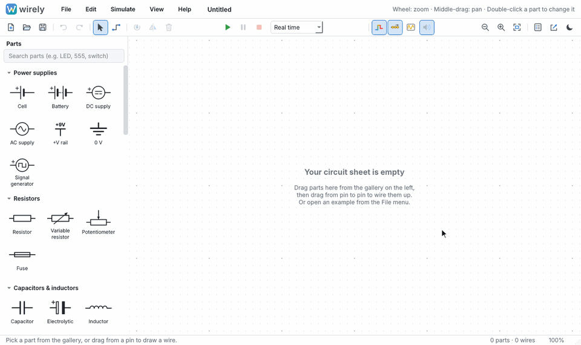

## Por qué existe Wirely

La idea era poder probar circuitos antes de construirlos — en el trabajo y en casa — con algo rápido y amigable de usar.
Los simuladores amigables de arrastrar y soltar son en su mayoría pagos y están orientados solo a escuelas, y las
herramientas profesionales gratuitas, como LTspice y ngspice, son potentes pero uno termina dedicando el tiempo a
netlists, modelos y ajustes de gráficos en lugar de al circuito.

Buscaba algo intermedio: un simulador que sea **tan fácil como dibujar el circuito**, pero **gratuito**, que **se
ejecute localmente** y sea **lo bastante preciso como para confiar en el trabajo** —

- bosqueje un circuito y **vea de inmediato** si funciona: qué se enciende, qué se calienta demasiado, qué revienta,
- **haga clic en los interruptores y arrastre los deslizadores** mientras se ejecuta, y **pase el mouse sobre
  cualquier cable** para leer su voltaje y corriente,
- mire las señales en un **gráfico (osciloscopio)** — temporizadores 555, filtros, PWM, un convertidor reductor,
- use números de componente reales (**BC547, 2N2222, TIP31, IRF540, IRLZ44N, LM358, TL071, PC817, 1N4148, 1N4007 …**),
- **exporte** diagramas limpios para informes, documentación y hojas de trabajo.

Así nació Wirely (con mucha ayuda de Claude, un asistente de IA), probando cada revisión contra respuestas
conocidas.

## Qué hace

- **Editor de esquemáticos** — una galería de 84 componentes con símbolos británicos (IEC) o estadounidenses,
  arrastrar y soltar, cableado arrastrando de pin a pin, uniones, rotar y voltear, deshacer/rehacer, copiar/pegar,
  notas de texto, guardado automático y recuperación ante bloqueos.
- **Simulación en vivo** — LEDs y lámparas que brillan (el PWM los atenúa, como en la vida real), motores con
  fuerza contraelectromotriz que se frenan bajo carga, relés que hacen clic, zumbadores y parlantes que se oyen,
  medidores con lecturas en vivo, cables coloreados por voltaje y flujo de corriente en movimiento.
- **Interactivo** — interruptores, pulsadores, interruptores magnéticos e inclinación, potenciómetros, sensores
  de luz y temperatura: haga clic y arrástrelos mientras el circuito se ejecuta.
- **Las cosas se rompen, como en la realidad** — LEDs sin resistencia, resistencias sobrecargadas, electrolíticos
  invertidos, transistores destruidos por el pico de voltaje de una bobina: revientan y le dicen por qué.
- **Lecturas** — un botón muestra el voltaje y la corriente en cada cable y el voltaje, la corriente y la potencia
  de cada componente mientras se ejecuta; haga clic en cualquier cable o componente para fijar solo su lectura; o
  **Copiar lecturas** para pegarlas todas en una planilla de cálculo.
- **Gráfico y sonda lógica** — hasta cuatro sondas, lecturas de frecuencia, tiempo y voltios por división ajustables.
- **Chips** — temporizador 555, amplificadores operacionales, comparadores (LM393, LM311), controlador de motor
  L293D, compuertas lógicas, contadores 4017, 4026 y 4060, decodificador 4511, display de 7 segmentos, reguladores
  de voltaje 7805/7809/7812/LM1117 y LM317, registros de desplazamiento 74HC164/165/595/597, conmutador analógico
  4051, referencias TL431/TLV431, optoacopladores (PC817, 4N25, 4N35, TLP521, 6N139), relés de estado sólido
  (TLP3122A), MOSFET, transistores, tiristores (SCR), relés, generador de señales con PWM.
- **Más componentes** — LEDs bicolor y RGB, puente rectificador, transformador, conmutador y relé DPDT, sensor de
  efecto Hall, solenoide, motor paso a paso, conmutador rotatorio, teclado de 12 teclas, reloj de cuarzo, biestable
  JK y NAND Schmitt (4093).
- **Cada tipo de componente explicado** — haga doble clic en un componente y elija su tipo: una línea debajo indica
  para qué sirve (p. ej., por qué elegiría un AO3400 en lugar de un 2N7002).
- **Exportar** — PNG, SVG y PDF (siempre sobre papel blanco), y una lista de materiales que puede copiar o guardar
  como CSV.
- **Se siente moderno** — un aspecto plano con temas claro y oscuro, una pantalla de inicio y un instalador que hace
  que los archivos `.wirely` se abran en Wirely con su propio icono.

| Editor y galería de componentes | Pase el mouse para leer cualquier cable | Convertidor reductor en el gráfico | Tema oscuro |
|---|---|---|---|
| 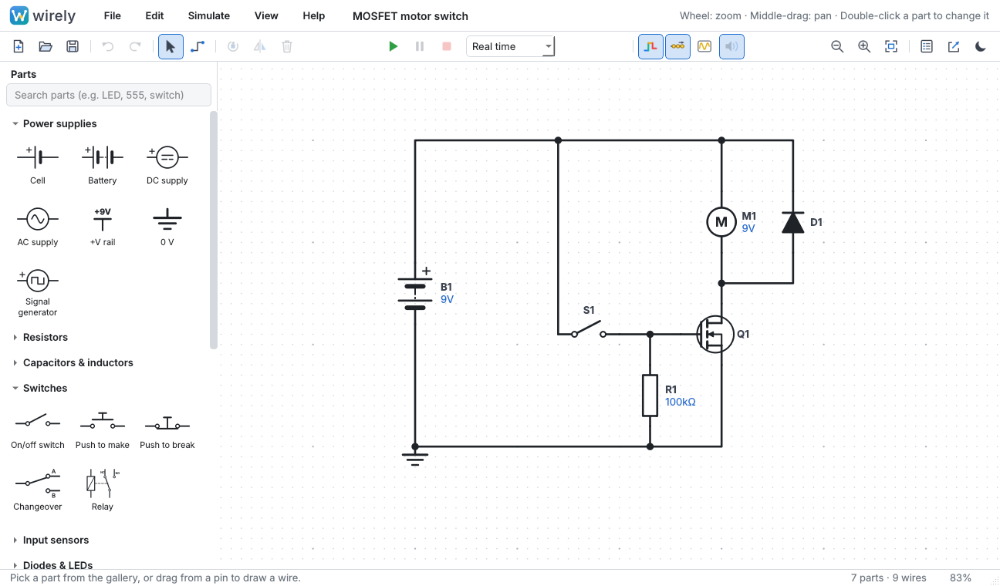 | 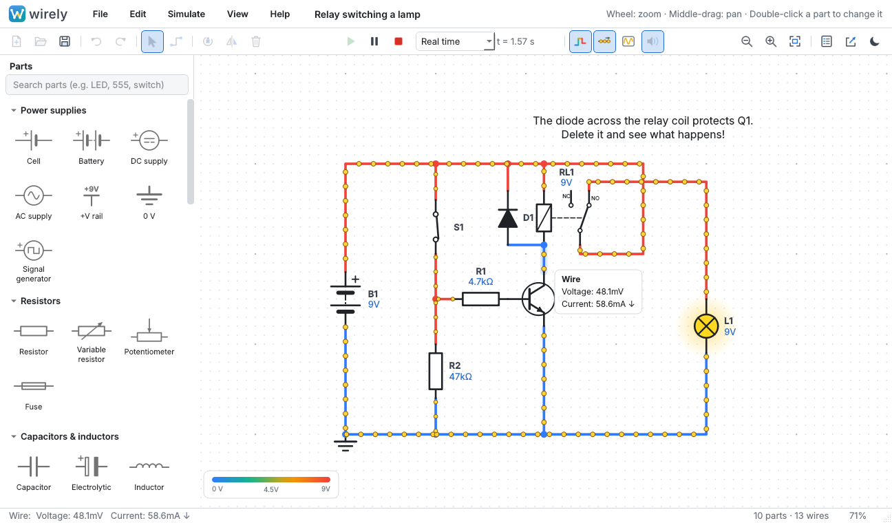 | 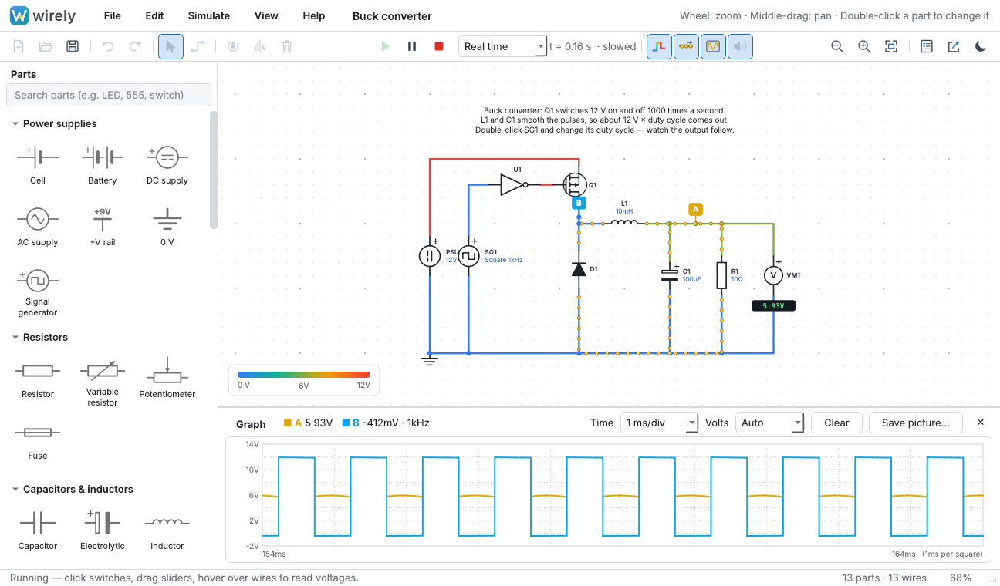 | 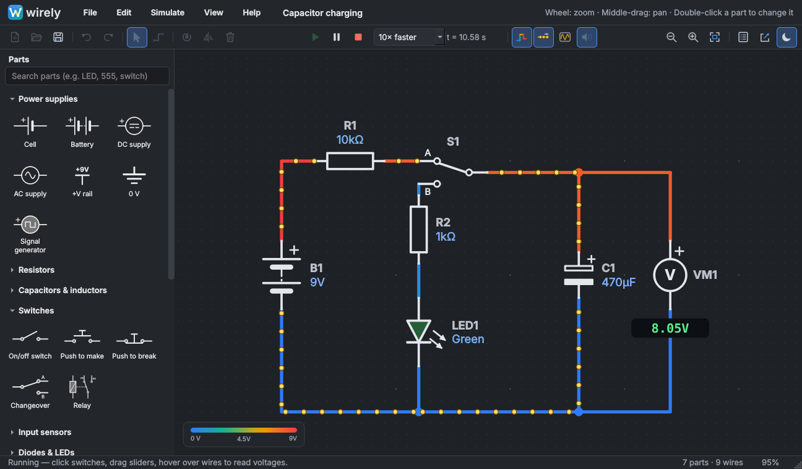 |

## Descarga e instalación

La app de escritorio **oficial, en inglés**, se descarga desde la
[**última versión**](https://github.com/wirely-app/wirely-app.github.io/releases/latest) — no necesita Python ni nada
más. Para tenerla **en español**, compílela desde el código con `build_exe.bat` (vea [ACTUALIZAR.md](ACTUALIZAR.md)).

- **Windows:** `Wirely-Setup-<version>.exe` — ejecútelo y siga el instalador. Agrega Wirely al menú Inicio y hace
  que los archivos `.wirely` se abran en Wirely. Es posible que Windows SmartScreen advierta la primera vez porque
  el instalador aún no está firmado digitalmente: haga clic en **Más información → Ejecutar de todos modos**.

- **Linux:** `Wirely-<version>-x86_64.AppImage` — hágalo ejecutable y ejecútelo:
  `chmod +x Wirely-*-x86_64.AppImage && ./Wirely-*-x86_64.AppImage`
  (o clic derecho → Propiedades → «Permitir ejecutar como programa», y luego doble clic). Si dice que falta FUSE,
  ejecútelo con `--appimage-extract-and-run`, o instale `libfuse2` (Ubuntu: `sudo apt install libfuse2t64`).
  Para agregarlo a su menú de aplicaciones: `bash packaging/linux/install-desktop.sh Wirely-<version>-x86_64.AppImage`.

<p align="center">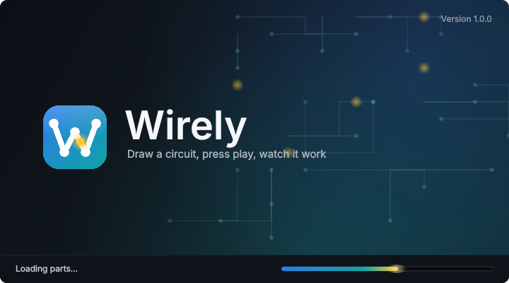</p>

### O úselo en un navegador web (Chromebooks, computadoras de la escuela)

Abra **[braiancerasa.github.io/wirely-es](https://braiancerasa.github.io/wirely-es/)** en Chrome, Edge, Firefox o
Safari — no hay nada que instalar y no hace falta cuenta. Es el mismo Wirely, traducido: los mismos componentes,
símbolos, ejemplos y simulador, ejecutándose dentro del navegador (el propio código Python de la app de escritorio,
ejecutado por [Pyodide](https://pyodide.org)). Sus circuitos permanecen en su computadora — no se sube nada, y el
sitio no usa cookies ni recopila datos personales. Después de la primera visita funciona sin conexión.

- **Guardar** le da un archivo `.wirely`, que se abre tanto en la versión web como en la app de escritorio.
- **Archivo → Copiar un enlace a este circuito** crea un enlace con el circuito dentro — péguelo en Google
  Classroom o Teams y cada persona que lo abra obtiene su propia copia.
- Después de la primera visita **funciona sin conexión**, y Chrome puede **instalarlo como app** (el botón de
  instalación en la barra de direcciones), así que aparece en el lanzador de un Chromebook.
- En un touchpad, el desplazamiento con dos dedos mueve la vista y el pellizco hace zoom; en una pantalla táctil,
  arrastre la hoja con un dedo.

<p align="center">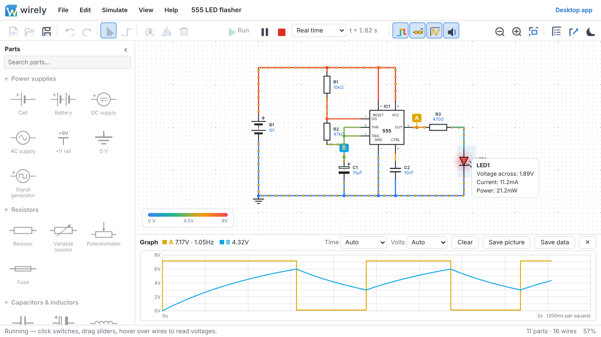</p>

La versión web es un poco más lenta que la app de escritorio y no puede exportar SVG ni PDF (guarda imágenes PNG).

¿Quiere ejecutarlo desde el código fuente, modificarlo o crear los instaladores usted mismo? Consulte
**[BUILDING.md](BUILDING.md)**, o la versión breve en [Para desarrolladores](#para-desarrolladores), más abajo.

## Véalo en funcionamiento

| Un 555 y un 4017 hacen un juego de luces secuenciales | Arrastre el deslizador del sensor de luz: se enciende la luz nocturna |
|---|---|
| 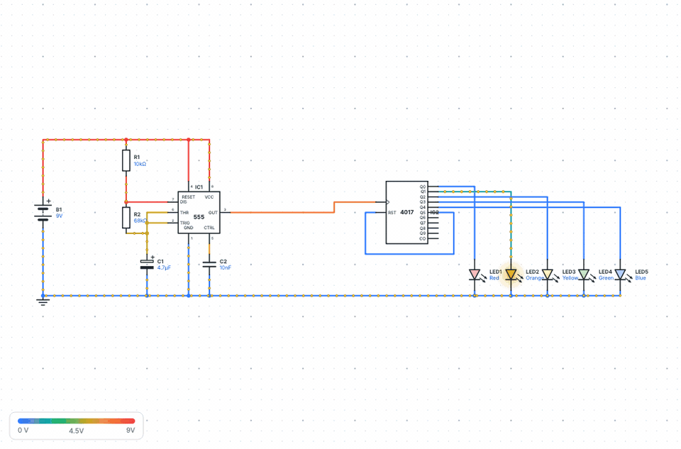 | 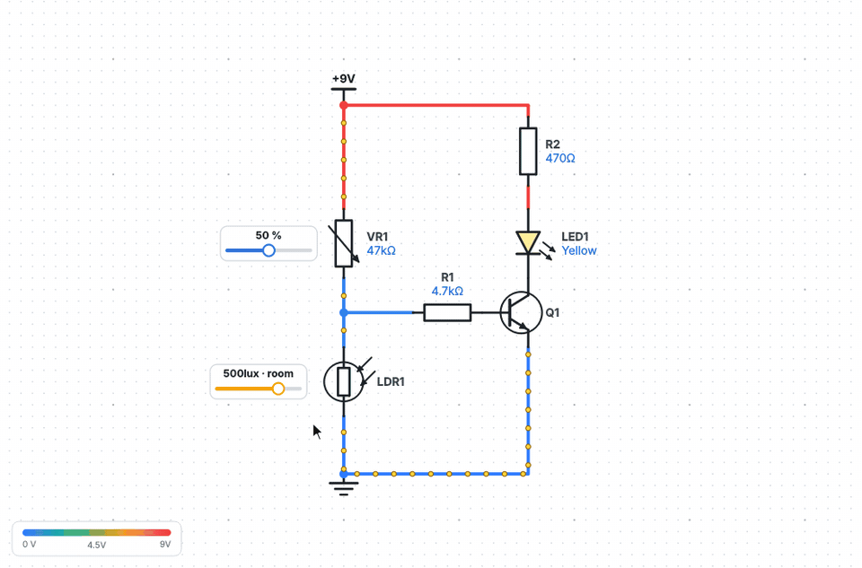 |

| Un motor consume una corriente alta al arrancar y menos después | ¿Sin resistencia? El LED revienta y explica por qué |
|---|---|
| 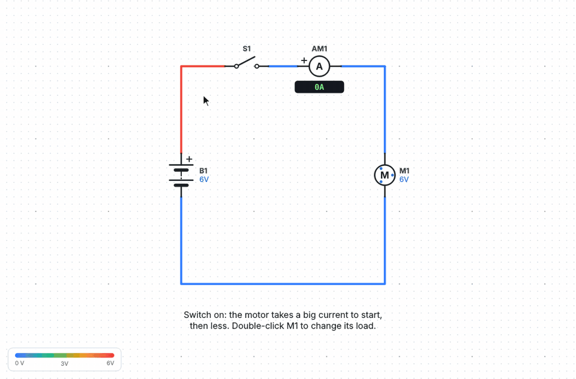 | 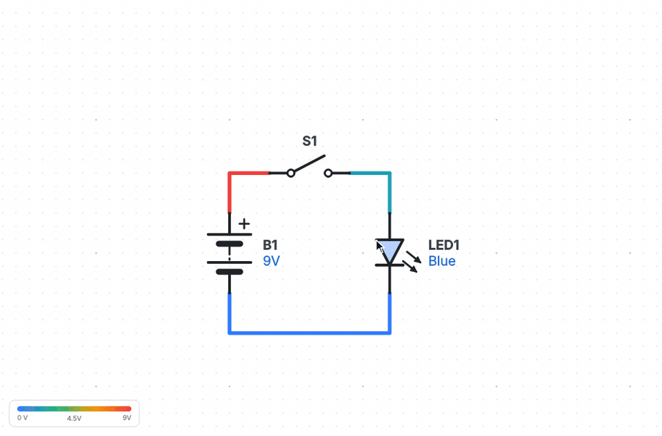 |

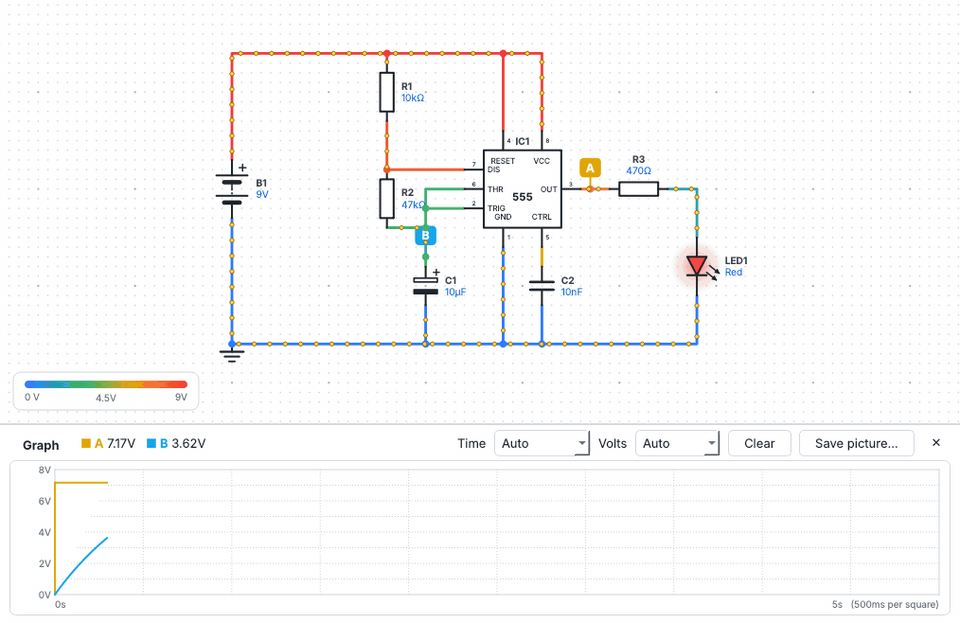

## Cómo funciona

### Dibujar un circuito


| Para… | Haga esto |
|---|---|
| Agregar un componente | Haga clic en él en la galería y luego en la hoja — o arrástrelo. Escriba en el cuadro de búsqueda para encontrar uno (`555`, `LED`, `relé`) |
| Conectar | Arrastre de un pin a otro. O haga clic en un pin, haga clic para agregar esquinas y luego haga clic en el pin final |
| Derivar un cable | Presione **W** (herramienta de cable), luego presione sobre el cable y arrastre — aparece un punto de unión |
| Cambiar un valor | Haga doble clic en el componente y escriba, p. ej., `10k`, `4k7`, `100n`, `4.7µ`, `2M2` |
| Elegir un componente real | Haga doble clic en un transistor, MOSFET, diodo, LED o amplificador operacional y elija su tipo |
| Rotar / voltear | **R** / **Shift+R** / **F** |
| Mover cosas | Arrastre componentes (sus cables lo siguen), arrastre un cable hacia un lado o arrastre el extremo suelto de un cable |
| Zoom / desplazar | Rueda del mouse / arrastrar con el botón central (o mantenga Espacio y arrastre). **Ctrl+0** ajusta todo el circuito |
| Notas | Agregue una **Nota de texto** (en *Etiquetas*) para explicar su circuito |
| Clic derecho | Un menú para lo que haya bajo el mouse |

Los valores aceptan la notación de ingeniería: `4k7` son 4,7 kΩ, `2M2` son 2,2 MΩ, `4R7` son 4,7 Ω, `100n` son 100 nF.

| Haga doble clic en un componente para cambiarlo | Lista de materiales (cópiela o guárdela como CSV) |
|---|---|
| 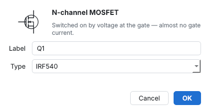 | 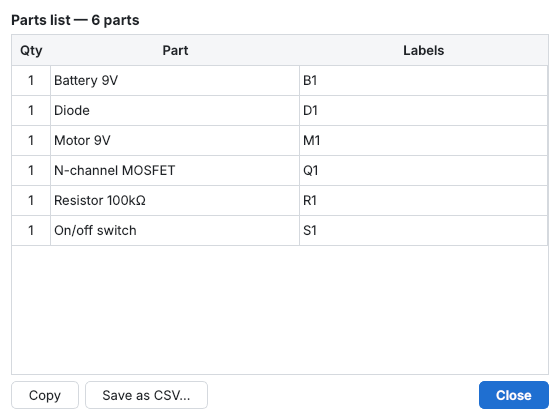 |

### Ejecutarlo

Presione **Ejecutar** (F5). Los cables toman el color de su voltaje (azul en 0 V hasta rojo en la alimentación más
alta — la escala está en la esquina) y circulan puntos por ellos para mostrar la corriente. Mientras se ejecuta:

- **haga clic** en los interruptores y **mantenga presionados** los pulsadores,
- **arrastre los deslizadores** que aparecen debajo de potenciómetros, resistencias variables y sensores (o use la
  rueda del mouse),
- **pase el mouse sobre cualquier cable o componente** para leer su voltaje, corriente (con sentido) y potencia,
- presione **Lecturas** para mostrarlas todas a la vez, o **haga clic** en un cable o componente para fijar su lectura
  en la hoja (arrastre una lectura para moverla),
- cambie la **velocidad** — desde 10× más rápido hasta 1/1000, para cámara lenta.

**Detener** (Shift+F5) vuelve a la edición y repara todo lo que haya reventado.


### El gráfico

Coloque **sondas de gráfico** (A–D, en *Medidores y sondas*) sobre los cables y presione Ejecutar — el gráfico se
abre debajo, como un osciloscopio. Cada sonda muestra su voltaje y frecuencia; ajuste el tiempo y los voltios por
división, o déjelos en Automático. Pase el mouse sobre el gráfico para leer valores y use **Guardar imagen…** para
conservarlo. **Ctrl+G** lo muestra u oculta.

| Filtro pasa bajos RC | Convertidor reductor (12 V de entrada, unos 5,7 V de salida) |
|---|---|
| 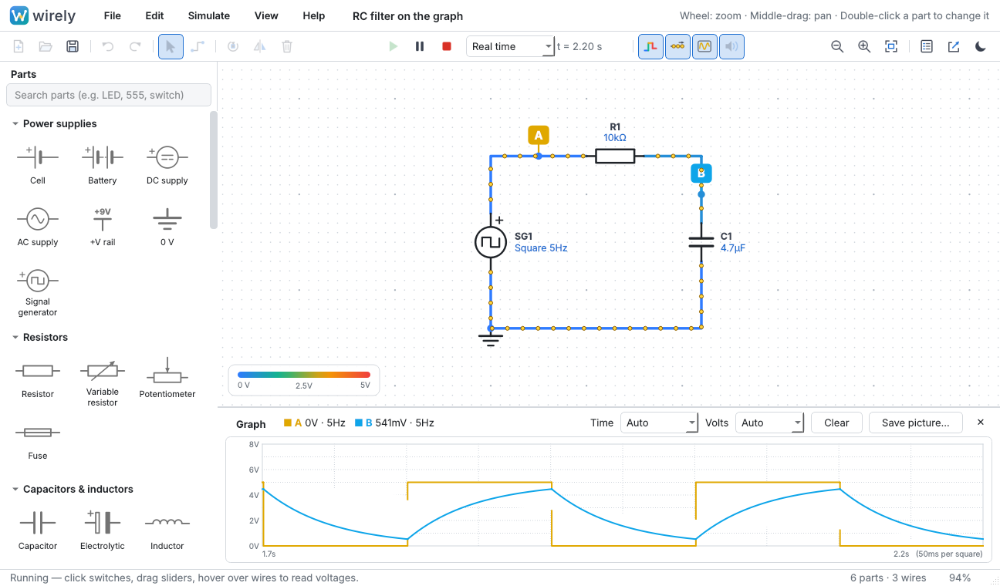 |  |

### Sonido

Los zumbadores zumban, los parlantes reproducen la señal **simulada** (un 555 a 690 Hz suena a 690 Hz incluso cuando
la simulación tiene que ir más lenta que el tiempo real), los motores zumban y los relés hacen clic. Apáguelo con el
botón de sonido.

### Cosas que se rompen

Como los componentes reales, las cosas fallan cuando se las exige demasiado — y Wirely le dice por qué:

- un LED directamente conectado a una batería (demasiada corriente — agregue una resistencia),
- una resistencia que lleva más que su potencia nominal,
- un condensador electrolítico conectado al revés,
- un transistor que conmuta una bobina de relé sin diodo de rueda libre (el pico de voltaje lo destruye — un MOSFET
  de potencia puede absorber un pico pequeño al entrar brevemente en ruptura, como los reales están especificados para
  hacerlo, pero uno pequeño no),
- un MOSFET con más voltaje entre sus terminales del que soporta, o un motor con demasiado voltaje,
- un fusible que se quema, o una fuente en cortocircuito.

### Lógica y chips

Las compuertas lógicas, el contador 4017, el decodificador 4511 y el display de 7 segmentos, el 555 y los
amplificadores operacionales funcionan mientras se ejecuta. Las **sondas lógicas** muestran alto y bajo. Los chips y
amplificadores operacionales con sus pines de alimentación sin conectar se alimentan automáticamente de la fuente más
alta del circuito, para que los bocetos rápidos funcionen.

| Compuertas lógicas con sondas lógicas | Binario a 7 segmentos | Sensor de oscuridad con amplificador operacional |
|---|---|---|
| 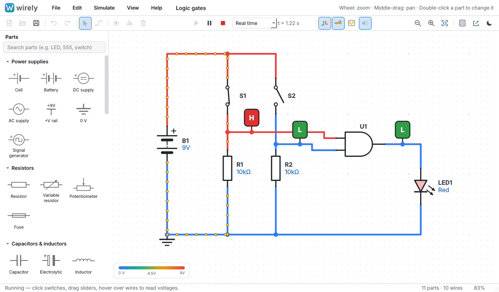 | 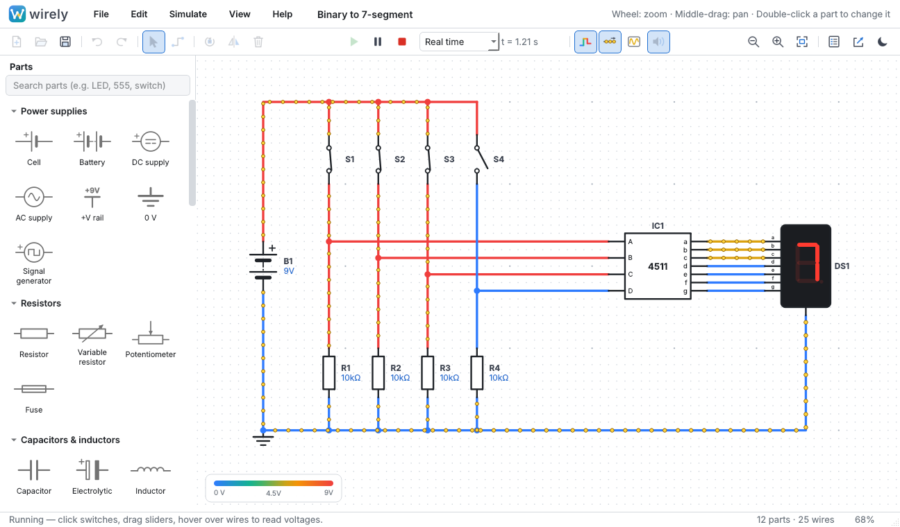 | 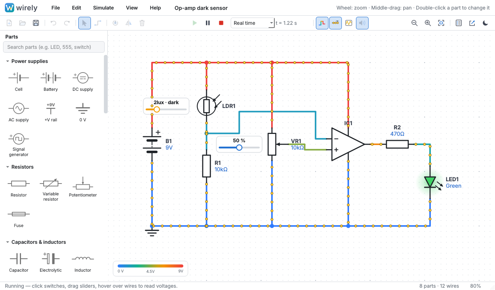 |

| Alarma antirrobo (interruptor magnético) | Alarma de lluvia (sensor de humedad) |
|---|---|
| 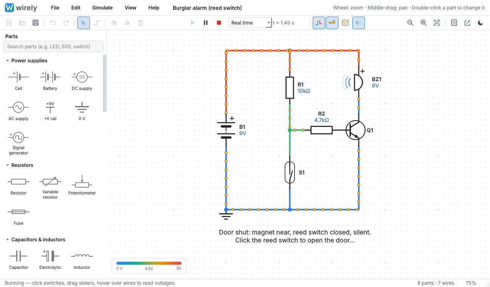 | 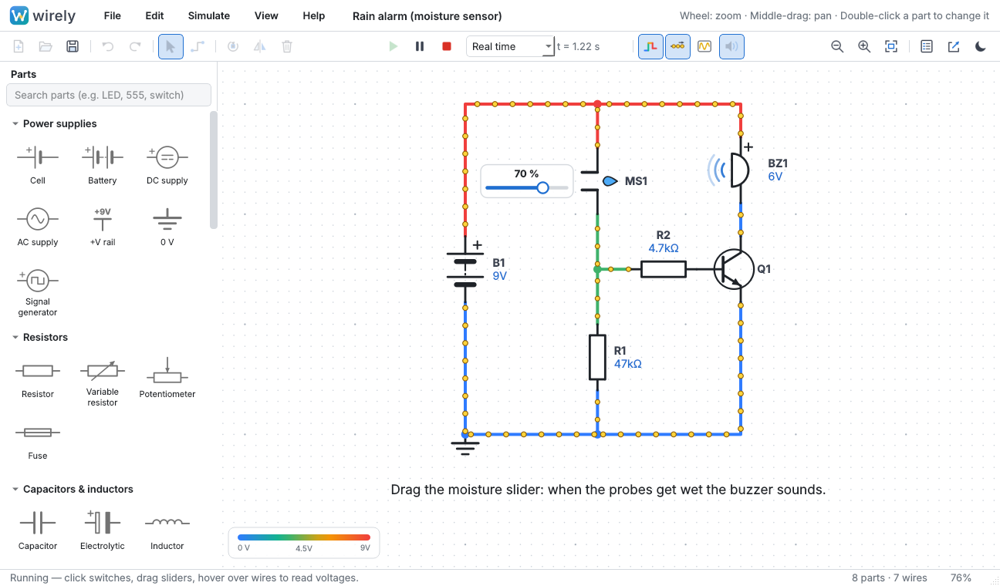 |

### Exportar

**Archivo → Exportar diagrama…** guarda PNG, SVG o PDF — siempre sobre papel blanco, listo para un informe o una
hoja de trabajo — y **Copiar diagrama como imagen** (Ctrl+Shift+C) lo pone directamente en el portapapeles.
**Archivo → Lista de materiales…** muestra la lista de componentes.

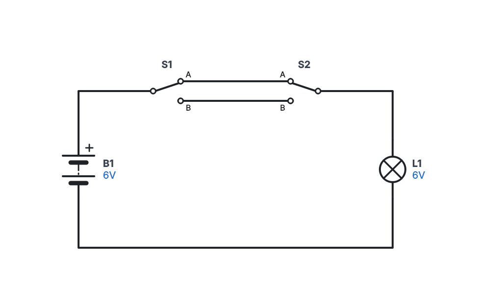

### Ejemplos

**Archivo → Abrir ejemplo** tiene 35 circuitos para abrir y probar, desde un LED y una resistencia, pasando por
temporizadores 555, lógica, amplificadores operacionales, relés y motores, hasta un convertidor reductor.

**Modo oscuro** — el botón de la luna arriba a la derecha. Presione **F1** en la app para ver todos los atajos de
mouse y teclado.

## ¿Qué tan preciso es?

Wirely tiene su propio solucionador de circuitos (`wirely/sim`), que usa el mismo método central que SPICE:
ecuaciones nodales, Newton–Raphson para diodos, LEDs, transistores y MOSFET (con limitación al estilo SPICE), e
integración en el tiempo con control automático del paso. Los chips que conmutan (el 555, la lógica, las ondas
cuadradas) le dicen al solucionador exactamente cuándo van a conmutar, de modo que coloca un paso de tiempo justo en
ese momento — así mantiene la precisión temporal.

**Los MOSFET están ajustados a sus hojas de datos.** Se ajustan el voltaje de umbral y la resistencia de encendido de
cada tipo a los voltajes de compuerta de la hoja de datos, y cada uno tiene su diodo de cuerpo, resistencia interna
de compuerta y capacitancias compuerta–fuente, compuerta–drenador (Miller) y drenador–fuente que cambian con el
voltaje como las reales. Así, la conmutación lleva tiempo real y la compuerta muestra la meseta de Miller:

| | Wirely | Hoja de datos |
|---|---|---|
| Carga de compuerta del AO3400 (a 4,5 V, 15 V, 5,7 A) | 6,1 nC | 6 nC |
| Carga de compuerta del FQP27P06 (a −10 V, −48 V, −27 A) | 32,3 nC | 33 nC |
| Resistencia de encendido en cada punto de prueba de la hoja de datos (12 tipos) | dentro del 2 % (IRLZ44N: 11 %) | |
| Corriente de drenador en Vgs(th) (12 tipos) | dentro del 3 % de la corriente de prueba | |

**Los amplificadores operacionales también están ajustados a las suyas:** ganancia en lazo abierto, ancho de banda de
ganancia, velocidad de subida (slew rate), corriente de polarización de entrada, resistencia de entrada, corriente de
alimentación, excursión de salida que se queda más corta con cargas más pesadas (un 741 con ±15 V: ±14 V en 10 kΩ,
±13 V en 2 kΩ), el LM358 que llega a 0 V pero no al riel superior, y límites de corriente. La corriente de salida
proviene realmente de los pines de alimentación, y un exceso de voltaje de alimentación destruye el chip.

Las pruebas automáticas (425) lo verifican contra resultados calculados a mano — divisores de voltaje, la ecuación del
diodo, corriente de LED, ganancia y saturación de transistores, regulación Zener, curvas RC y RL, un rectificador de
media onda, temporización astable y monoestable del 555, ganancias, ancho de banda, velocidad de subida y corrientes
de polarización de amplificadores operacionales, un oscilador con disparador Schmitt, tablas de verdad lógicas y
contadores —, contra las hojas de datos anteriores y contra **ngspice** ejecutando los mismos modelos. Por ejemplo:

| | Wirely | ngspice |
|---|---|---|
| Voltaje de salida del convertidor reductor | 5,750 V | 5,759 V |
| Rizado de salida del convertidor reductor | 0,391 V | 0,391 V |
| Corriente de rizado del inductor del convertidor reductor | 0,315 A | 0,315 A |
| Conmutación del IRF540: retardo de encendido / apagado (resistencia de compuerta de 100 Ω) | 122 / 569 ns | 122 / 566 ns |

Las lámparas de filamento se calientan y su resistencia aumenta con el voltaje, por lo que su curva corriente–voltaje
se dobla (corriente ∝ V^0.6, como miden las lámparas reales) — y una lámpara fría recibe una corriente de irrupción de
unas 11 veces su corriente de régimen al encenderse. Los motores tienen fuerza contraelectromotriz, los relés tienen
una bobina con inductancia que se activa al 75 % y se suelta al 30 % de su corriente nominal, y conmutar una carga
inductiva sin diodo de rueda libre produce un pico de voltaje real.

## Límites honestos

Wirely sirve para probar circuitos rápidamente y ver cómo se comportan. No reemplaza un paquete SPICE completo ni la
prueba del circuito real:

- **Sin diseño de PCB ni protoboard** — es para el esquemático y la simulación.
- **Todavía no importa modelos SPICE ni exporta netlists.** Los componentes usan modelos incorporados de componentes
  reales comunes (se eligen de una lista), ajustados a valores típicos de hoja de datos. No hay efectos de
  temperatura, voltaje de offset ni ruido en los amplificadores operacionales, y los amplificadores operacionales
  tienen un solo polo (así que no hay oscilación con cargas capacitivas).
- **Sin análisis de AC (barrido de frecuencia), ruido ni Monte Carlo** — el gráfico es en el tiempo, como un
  osciloscopio.
- **La lógica es simple** — compuertas, el 4017, el 4511 y biestables D; sin microcontroladores.
- Los circuitos de conmutación rápida (como el convertidor reductor a 1 kHz) se ejecutan **más lento que el tiempo
  real** — la etiqueta de tiempo dice «ralentizada». Los resultados siguen siendo correctos; solo tardan más en
  llegar.
- El sonido depende del sistema de audio de su computadora; si no se puede abrir, Wirely simplemente queda en
  silencio.
- La versión web necesita un navegador reciente, tarda unos segundos en iniciar la primera vez (descarga unos 14 MB)
  y guarda las imágenes solo como PNG.

## Para desarrolladores

```
python -m pip install PySide6 numpy pytest
python -m pytest tests              # pruebas del modelo, del solucionador y del editor (no hace falta pantalla)
python -m wirely "examples/Luz nocturna.wirely"
```

O haga doble clic en `run_wirely.bat` (Windows) / ejecute `./run_wirely.sh` (Mac y Linux) — el primer inicio configura
su propio entorno de Python. Si Smart App Control de Windows bloquea el `.bat`, haga doble clic en **`start.py`** en su
lugar.

El modelo de circuito (`wirely/model`) y el solucionador (`wirely/sim`) son Python puro sin Qt, así que se pueden
probar por separado; la interfaz de usuario está en `wirely/ui`. Las imágenes del README se generan con
`tools/readme_media.py`. La versión web vive en `web/`: `web/py/qtshim.py` reemplaza las partes de Qt que usan el
código de la hoja y de dibujo (registrando el dibujo para que la página lo reproduzca en un canvas), y
`python tools/build_web.py` compila el sitio (consulte BUILDING.md). Consulte [BUILDING.md](BUILDING.md) para crear
los instaladores y saber cómo funcionan las compilaciones automáticas de GitHub, y [CHANGES.md](CHANGES.md) para ver
las novedades.

## Licencia

Wirely es software libre: puede redistribuirlo y/o modificarlo bajo los términos de la **Licencia Pública General de
GNU, versión 3** (o cualquier versión posterior) — consulte [LICENSE](LICENSE).
En resumen: úselo para lo que quiera, incluso en el trabajo; compártalo, modifíquelo — y si comparte una versión
modificada, comparta también su código fuente bajo la GPL.

Copyright © 2026 Richard Willmott.

Está construido sobre bibliotecas de código abierto — Qt / PySide6 (LGPL) y numpy (BSD); consulte
[THIRD-PARTY-NOTICES.txt](THIRD-PARTY-NOTICES.txt). Todos los iconos y símbolos fueron dibujados para Wirely. Wirely
es un proyecto independiente y no está vinculado con ningún otro simulador de circuitos ni con sus creadores.
